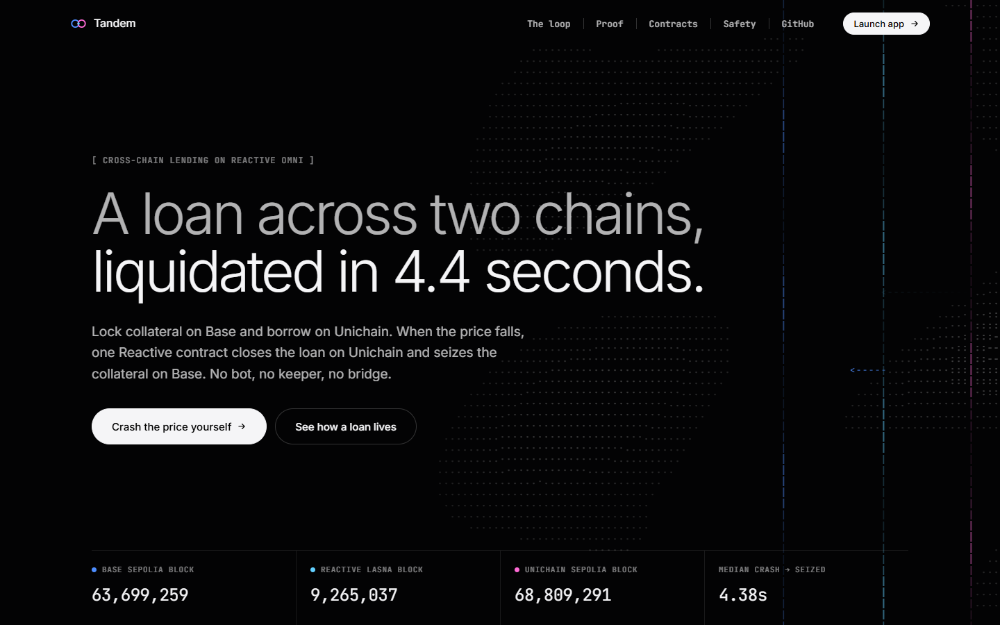
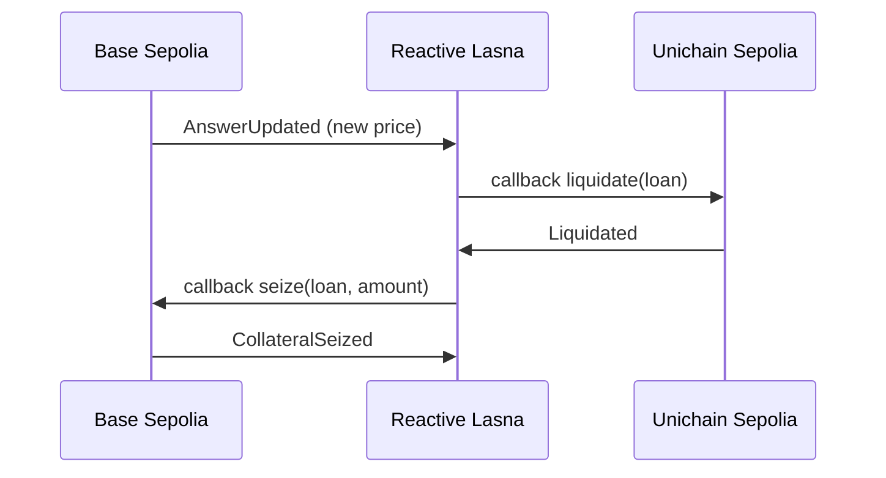
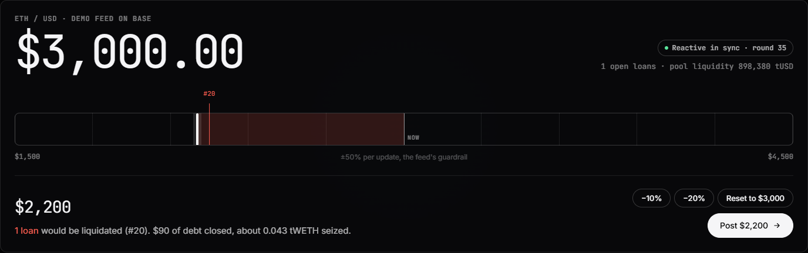
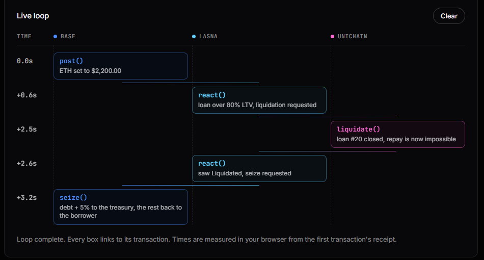

# Tandem

Cross-chain lending where Reactive does the liquidating. You lock collateral on Base, borrow on Unichain, and if the collateral price falls too far, a Reactive contract closes the loan on Unichain and seizes the collateral on Base. No keeper bot, no off-chain server, no bridge.

Built for the [Reactive Omni Buildathon](https://dorahacks.io/hackathon/reactive-omni-buildathon/detail), **Every Second Counts** track. Everything runs on testnets: Reactive Lasna, Base Sepolia and Unichain Sepolia.

**Live app:** _add the Vercel URL after deploying_ · **Demo video:** _add the link_ · **Source:** https://github.com/KingClaszzz/tandem



In the 15 liquidations we measured on the live testnets, the time from the price transaction landing on Base to the collateral being seized on Base again had a **median of 3.9 seconds** (p95 4.9 s). The raw runs, with every transaction hash, are in [`evidence/`](evidence/).

---

## Contents

1. [The problem](#the-problem)
2. [What Tandem does](#what-tandem-does)
3. [Why this needs Reactive](#why-this-needs-reactive)
4. [Measured results](#measured-results)
5. [Deployed contracts](#deployed-contracts)
6. [How a loan behaves](#how-a-loan-behaves)
7. [Security](#security)
8. [Try it](#try-it)
9. [Run it yourself](#run-it-yourself)
10. [Repository layout](#repository-layout)
11. [Things we ran into on Omni](#things-we-ran-into-on-omni)
12. [Limits](#limits)
13. [How this was built](#how-this-was-built)

---

## The problem

A lending market is only safe if bad loans get closed before they go underwater. That is easy when the collateral and the debt are on the same chain: one contract sees both and can act in one transaction.

It gets hard when they are on different chains. The contract that holds the debt cannot see the collateral price on the other chain, and nothing on-chain wakes it up when the price drops. In practice someone runs a bot. The bot watches one chain, holds keys and gas on both, and races other bots. If it is slow or down, the lender takes the loss.

Reactive's previous network produced a block roughly every 7 seconds, which made a two-chain loop like this too slow to be useful. Omni produces about one block per second with instant finality, so the whole round trip now fits in a few seconds.

## What Tandem does

There are four contracts that matter, split across three chains.

| Chain | Contract | Job |
| --- | --- | --- |
| Base Sepolia | `PriceFeed` | Demo ETH/USD feed. Emits Chainlink's `AnswerUpdated` event. |
| Base Sepolia | `CollateralVault` | Holds the borrower's tWETH. Releases or seizes it only when told to by Reactive. |
| Unichain Sepolia | `LendingPool` | Holds the tUSD. The source of truth for who owes what. |
| Reactive Lasna | `TandemReactive` | Watches eight events on the other two chains, keeps a mirror of every loan, and decides. |

There are three loops, and each one starts with an event and ends with a callback.

**Borrow.** The user locks tWETH in the vault and asks for some tUSD. Reactive sees `CollateralLocked`, checks that the loan is at most 70% of the collateral's value, at least 50 tUSD, and within the per-borrower and global limits. If it passes, Reactive tells the pool to pay out. If not, it tells the vault to give the collateral back.

**Repay.** The user repays on Unichain. Reactive sees `Repaid` and tells the vault to release the collateral.

**Liquidate.** Someone posts a new price to the feed. Reactive sees `AnswerUpdated`, finds every open loan that is now above 80% LTV (up to 10 per update), and tells the pool to close each one. When the pool confirms with `Liquidated`, Reactive prices the seizure and tells the vault to take the collateral: debt plus a 5% penalty goes to the treasury, and anything left over goes back to the borrower.



The pool closes the loan first and the vault seizes second, on purpose. Once `liquidate()` lands on Unichain, `repay()` on that loan reverts. So a borrower can never pay back the debt and also lose the collateral. The full state machine is in [`docs/DESIGN.md`](docs/DESIGN.md).

There is also a console at `#/app` with seven views:

| View | What it is for |
| --- | --- |
| Overview | Collateral locked, debt, pool liquidity, coverage, a price chart with every open loan's liquidation level drawn on it, the loans closest to liquidation, an LTV histogram. |
| Borrow | Lock collateral and borrow, with the price buffer and the rules shown before you sign. |
| Positions | Your loans as cards with health bars, plus every loan in the market. Each loan shows whether the three chains agree about it. A Guardian can send a browser notification when one of your loans gets close to its liquidation price. |
| Risk and price | The price ruler (drag it to see who would be liquidated before you post anything), a stress test of the whole book from -5% to -50%, and a calculator for a loan that does not exist yet. |
| Latency lab | The benchmark broken down by hop, the loops you ran yourself (saved in your browser), and an explicit estimate of the same loop on the old 7-second network. |
| Activity | A live feed of events from all three chains, and a replay of any of the 15 recorded liquidations with the real timings. It needs no wallet. |
| System | Fuel gauges for the reactive contract, the vault and the pool, chain health, whether Reactive is keeping up with the price feed, parameters, and the contracts. |

Every loop you start shows what it cost the operator, from the change in the contracts' balances. The wallet menu has Switch account and Disconnect.



## Why this needs Reactive

Take Reactive out and you have to replace three things.

1. **Something that notices the price moved.** A contract on Unichain cannot subscribe to Base events by itself. You would run a server that watches Base.
2. **Something that decides which loans are unhealthy.** Here that logic is Solidity in `TandemReactive`, and it runs where the events arrive. Off-chain, it is code on your server.
3. **Something that sends the follow-up transactions.** The bot needs a key and gas balance on both chains. Here the callbacks are authenticated by each chain's callback proxy, and the destination contracts only accept calls from the reactive contract's address. There is no key that can liquidate anyone.

A cross-chain messaging protocol could carry the messages, but something still has to notice the price change and choose which loans to act on. In Tandem that is the reactive contract, so removing it removes the product.

The loop also has to be fast to matter. A single block on the previous Reactive network (about 7 seconds) is longer than the whole loop we measure on Omni.

## Measured results

Every number below comes from [`scripts/bench.ts`](scripts/bench.ts), run against the live testnets on 2026-11-26 on the current contracts. Each run borrows at 60% LTV, then posts a price that puts the loan at 81.8%, then waits for the seize. The feed accepts one update per 30 seconds, so each run takes a little over a minute and the 15 runs took about 20 minutes. The raw output, with every transaction hash, is [`evidence/bench-2026-11-26T04-56-28-608Z.json`](evidence/bench-2026-11-26T04-56-28-608Z.json).

| Hop | p50 | p95 | max |
| --- | --- | --- | --- |
| Price tx on Base → Reactive reacts | 1.47 s | 2.09 s | 2.09 s |
| Reactive → debt closed on Unichain | 1.77 s | 2.32 s | 2.32 s |
| Unichain → Reactive reacts again | 0.41 s | 1.05 s | 1.05 s |
| Reactive → collateral seized on Base | 0.29 s | 0.31 s | 0.31 s |
| **Price tx → collateral seized** | **3.89 s** | **4.89 s** | **4.89 s** |

The fastest full loop was 3.4 s and the slowest 4.9 s. A cross-chain borrow (lock on Base to tUSD in the wallet on Unichain) had a median of 3.0 s. With 15 runs, the p95 and the max are the same number, so read them as "the slowest we saw".

The first deployment (archived in [`archive/v1`](archive/v1)) measured a median of 4.38 s and a p95 of 5.22 s over its own 15 runs on 2026-11-25. The two sets differ by less than the spread between runs on public RPCs, so we do not claim the hardened contracts are faster. We only claim they are not slower.

**How it is measured.** The script starts a clock when the origin transaction's receipt arrives, then polls each chain's public RPC every 250 ms and records when each event first shows up. So every figure includes RPC latency and is only accurate to about a quarter of a second. We did not use block timestamps because Base Sepolia blocks come every 200 ms and timestamps only have one-second resolution.

**What to take from the hops.** The two longest hops are the price transaction reaching Reactive (1.5 s median) and Reactive reaching Unichain (1.8 s). The return legs are fast. We did not investigate why those two are slower, so we do not claim it is inherent to either network.

One full liquidation from the smoke run, so you can open every step yourself (from [`evidence/smoke-2026-11-26T04-39-37-822Z.json`](evidence/smoke-2026-11-26T04-39-37-822Z.json)):

| Step | Seen after | Transaction |
| --- | --- | --- |
| Price posted on Base | 0 s | [`0x75dfc4…1d75`](https://sepolia.basescan.org/tx/0x75dfc450d68a53753e881289dc9cd089aecf784a6e051e9211687499ed691d75) |
| Reactive requests the liquidation | 1.09 s | [`0x37534e…05e1`](https://lasna.reactscan.net/tx/0x37534e028f5bbb07fe2e7ed34abb6177da23fa23d2b14d2fae04fe36858505e1) |
| Loan closed on Unichain | 2.40 s | [`0x6cff04…fa1f`](https://sepolia.uniscan.xyz/tx/0x6cff04df59789d6b65c3d5196e2b7b56afdd97d59b2766f6ce4659e27467fa1f) |
| Reactive requests the seize | 2.76 s | [`0x6683dd…3eb9`](https://lasna.reactscan.net/tx/0x6683ddf223df1d2737e66303b7841a96e85c5c73b5aec2105925332349913eb9) |
| Collateral seized on Base | 3.04 s | [`0x4871ef…12e7`](https://sepolia.basescan.org/tx/0x4871efe12c9e63ffbeae16b2ed101cf74d4f06ebe6d5874316082ce6af9812e7) |

The same run also covers the other loops: a borrow ([`lock`](https://sepolia.basescan.org/tx/0x12d07cbf0afb96927bc7c650c3cd262171e516e41940212cf44203bf178dff4c) → [`disburse`](https://sepolia.uniscan.xyz/tx/0x1721655a729b2535b5531d1632a587a31126838b35621d6271e9c0e83d73f164)), a repay ([`repay`](https://sepolia.uniscan.xyz/tx/0x5b6228c5ff4fe910c799e1134d1454d1eb63f470f1c43e9e6a52e83f013a5954) → [`release`](https://sepolia.basescan.org/tx/0x97ff61d2ab4ab9f96f01296d0538812ca4b8981c157dd81522cd4f405ed5f037)), and a refused borrow at 73% LTV ([`lock`](https://sepolia.basescan.org/tx/0x7c5390e4e3dfd57fb64fe25c255276c8d6b16cce1b90d8082cc5b886021e97f0) → [`release`](https://sepolia.basescan.org/tx/0x31fab0eb84bb63bf352051509e681e1532204600fd73210d15153e82dd4123ce)).

The console reproduces this in the browser. We drove it end to end on the testnets through the real UI (borrow, move the price, watch the seize, reset the price), and the in-page trace measured a liquidation in about 3 to 4 s.



## Deployed contracts

All six are verified on [Sourcify](https://sourcify.dev) with an exact match. Deployed 2026-11-26.

| Contract | Chain | Address |
| --- | --- | --- |
| `TandemReactive` | Reactive Lasna (5318007) | [`0x502F34A50C444DF01308661Dd7Fb4bBf10cDb13a`](https://lasna.reactscan.net/address/0x502F34A50C444DF01308661Dd7Fb4bBf10cDb13a) |
| `PriceFeed` | Base Sepolia (84532) | [`0xb32310246557348B083A863b0B0d581130c1829d`](https://sepolia.basescan.org/address/0xb32310246557348B083A863b0B0d581130c1829d) |
| `CollateralVault` | Base Sepolia | [`0xf443857bAAf46424B21915aA0958c9688AA59e53`](https://sepolia.basescan.org/address/0xf443857bAAf46424B21915aA0958c9688AA59e53) |
| `tWETH (test collateral)` | Base Sepolia | [`0x85B33d8C24E887a65A5759cFC398d99748696f1D`](https://sepolia.basescan.org/address/0x85B33d8C24E887a65A5759cFC398d99748696f1D) |
| `LendingPool` | Unichain Sepolia (1301) | [`0x0fA40e8E0932AA643385d6A1Cb416945B234feb0`](https://sepolia.uniscan.xyz/address/0x0fA40e8E0932AA643385d6A1Cb416945B234feb0) |
| `tUSD (test loan asset)` | Unichain Sepolia | [`0xeA9Ee553A97F671917fADADBCe7B10DCb13Af0Cf`](https://sepolia.uniscan.xyz/address/0xeA9Ee553A97F671917fADADBCe7B10DCb13Af0Cf) |

The addresses are also in [`deployments.json`](deployments.json), together with each deployment transaction.

<details>
<summary>The first deployment (2026-11-25), kept as evidence</summary>

It has the three flaws listed under [Security](#security) and no feed cooldown. Its 15-run benchmark and its sources are in [`archive/v1`](archive/v1). All six were verified on Sourcify as well.

- `reactive` [`0x99CabeF8D2598eb2F067704247943678bF262726`](https://lasna.reactscan.net/address/0x99CabeF8D2598eb2F067704247943678bF262726)
- `feed` [`0x0BA819E60Dbc79adad9F556982e09D3E7DbB6C4E`](https://sepolia.basescan.org/address/0x0BA819E60Dbc79adad9F556982e09D3E7DbB6C4E)
- `vault` [`0x4a1FbD0B69834428B7450EA4fC671A933f1e2c81`](https://sepolia.basescan.org/address/0x4a1FbD0B69834428B7450EA4fC671A933f1e2c81)
- `pool` [`0x0BA819E60Dbc79adad9F556982e09D3E7DbB6C4E`](https://sepolia.uniscan.xyz/address/0x0BA819E60Dbc79adad9F556982e09D3E7DbB6C4E)
- `tWETH` [`0x99CabeF8D2598eb2F067704247943678bF262726`](https://sepolia.basescan.org/address/0x99CabeF8D2598eb2F067704247943678bF262726)
- `tUSD` [`0x99CabeF8D2598eb2F067704247943678bF262726`](https://sepolia.uniscan.xyz/address/0x99CabeF8D2598eb2F067704247943678bF262726)

</details>

## How a loan behaves

The reactive contract keeps a mirror of every loan and moves it through these states:

```
Pending ──Disbursed──▶ Active ──price drops──▶ Liquidating ──Liquidated──▶ Seizing ──CollateralSeized──▶ Seized
   │                      │                          │
   │ BorrowRejected       │ Repaid (can win a race)  │ Repaid
   ▼                      ▼                          ▼
Releasing ◀───────────────┴──────────────────────────┘
   │ CollateralReleased
   ▼
Released
```

A loan only reaches a final state (`Released` or `Seized`) when the destination chain confirms it with an event. Reactive does not assume that a callback worked.

Callbacks can fail, for instance if a destination contract runs out of the ETH it needs to pay for callbacks. So the reactive contract records when it last made a request for each loan, and anyone can call `poke(loanId)` to re-send a request that has gone a minute without an answer. This is safe because every callback only acts on the state it expects: sending the same `disburse` twice pays once, and a repeated `seize` moves nothing. The console shows a **Poke** button on any loan that has been stuck for more than a minute, and `npm run status -- --poke` does the same from the command line.

Parameters (all in `TandemReactive`):

| | |
| --- | --- |
| Max loan-to-value to borrow | 70% |
| Liquidation threshold | 80% |
| Liquidation penalty | 5% |
| Minimum loan | 50 tUSD |
| Open loans per borrower | 3 |
| Open loans in total | 50 |
| Liquidations per price update | 10 |
| Retry delay for `poke` | 60 s |

## Security

[`docs/DESIGN.md`](docs/DESIGN.md) has the full threat model. The short version:

- **Only Reactive can move collateral or debt.** `release`, `seize`, `disburse` and `liquidate` are callable only by the chain's callback proxy, and only when the proxy reports the reactive contract as the sender. There is no owner key that can call them.
- **Spoofed events are ignored.** `react()` checks the chain ID and the exact feed, vault and pool addresses before it acts on a log. A look-alike contract emitting `AnswerUpdated` does nothing.
- **No double outcome.** Liquidation closes the debt before collateral is seized. A repay that arrives first beats a liquidation that arrives later, and the other way round, but never both.
- **Old prices are ignored.** The reactive contract only accepts a feed round that is newer than the last one it processed.
- **Bounded work.** Open loans, loans per borrower and liquidations per update are capped. The worst case in the tests, 50 open loans and 10 liquidated in one update, used about 489k gas. The cap per reactive transaction is 900k.
- **No admin powers.** The owner of `TandemReactive` can call `configure()` exactly once, to wire up the other contracts. After that the owner can do nothing. There is no pause, upgrade or withdraw function.

**Tests.** `npm test` runs 42 contract tests. `SRC=archive/v1/contracts npx hardhat test` runs the same suite against the first deployment, where 7 of them show as pending: those are the known issues above, written as tests. They cover the three loops, a refused borrow (over the LTV limit), loans the vault rejects at the origin (size, per-wallet and global caps), a pool with no liquidity, a loan that arrives while the price is already low, a repay racing a liquidation, dropped `disburse`, `seize` and `release` callbacks recovered with `poke`, spoofed callers and spoofed events, replayed price rounds, duplicate callbacks, the feed's guardrails, and the gas test above. The system contract and callback proxies are mocked in these tests. On top of those there are attack tests (spam, oversized loans, sybil borrowers draining the pool, repaying someone else's loan) and randomised runs: 6 seeds of 40 random steps each (borrow, repay, price moves, callbacks dropped on purpose, pokes), after which the tests check that tokens are conserved, that no loan is both repaid and seized, that every loan ends in a consistent state on all three chains, and that the reactive contract's counters match. `cd web && npm test` runs 6 more for the console's loan maths, and `node scripts/e2e-failures.mjs` runs 11 scenarios in a real browser with a misbehaving wallet (no wallet, user rejects, wrong chain, a hung or failing wallet, hostile error text, the RPC going down, junk input, disconnect). None of those send a transaction.

We have not had this audited, and it is test-token software on testnets. Treat the list above as what we checked, not as a claim that nothing is wrong.

### What the security pass found, and what changed

A security pass on 2026-11-26 attacked the first deployment with tests written as properties the system must have. It found three problems. We fixed them and redeployed, and kept the first deployment in [`archive/v1`](archive/v1) because its measurements and verified source are still evidence.

1. **Anyone could make the reactive contract spend its fuel.** `PriceFeed.post()` had no cooldown, so every post cost the operator one reaction (about 0.017 lREACT), and a script could post until the contract was empty. In the test, 12 posts in a row were accepted. When that happens the network stops delivering reactions and open loans stay locked until the contract is topped up. Funds are not lost, but nothing moves.
2. **The vault accepted loans Reactive then refused** (too small, too large, a fourth loan from one wallet, over the global cap). Each cost a paid reaction and a paid release callback.
3. **A borrow amount above 2^236 made `react()` revert**, which locked that borrower's own collateral.

What the current contracts do instead:
- The feed accepts one update per 30 seconds from anyone and rejects an update that changes nothing. That caps the spam at 2 reactions a minute.
- The vault enforces the size limits (50 to 5,000 tUSD), 3 open loans per wallet and 50 in total, at the origin, where a revert costs Reactive nothing. That also bounds how much of the pool all borrowers together can take.
- The reactive contract range-checks what it decodes, so `react()` cannot revert on an event it accepts.

What is still true: a determined attacker who pays gas on three chains can still make Reactive run, only at a slower rate. The real answer to that is a fee per loan that pays for the reactions it causes. We did not add it, because it would make the demo harder to try with scarce testnet ETH. So the console shows the reactive contract's fuel, pauses new loans when it is empty, and `npm run guard` pays any debt and tops up what is low.

## Try it

You need a browser wallet (MetaMask, Rabby) and a little Sepolia ETH on **both** Base Sepolia and Unichain Sepolia for gas. About 0.001 ETH on each is plenty. You do not need any REACT: the reactive contract is already funded, and the callbacks are paid by the destination contracts.

Open the app, go to the console, and:

1. Connect the wallet.
2. Press **Mint 2 tWETH** (Base Sepolia). The faucet is public.
3. Lock 0.05 tWETH at 60% LTV. You get 90 tUSD on Unichain after a few seconds. Watch the **Live loop** panel fill in, one box per transaction.
4. A tick appears on the price ruler at $2,250. Drag the handle below it and press **Post**.
5. Watch the loan get liquidated and seized. The panel shows each step with its time and a link to the explorer.
6. Press **Reset to $3,000** to put the price back for the next person.

The feed is a demo feed that anyone can move, once every 30 seconds, so someone else may already have moved it, and after a crash you wait for the counter before you can reset it. Everything in the console is read from the chains, not from a database, so what you see is the current state. Try a loan at 73% LTV too: Reactive refuses it and the vault hands the collateral back, and that is on-chain as well.

Without a wallet the console is read-only. The landing page also lets you step through any of the 15 recorded runs.

## Run it yourself

Requirements: Node 20 or newer and a wallet **used only for testnets**.

```bash
git clone https://github.com/KingClaszzz/tandem
cd tandem
npm install
npm test                      # 42 contract tests, no network needed
```

To deploy your own copy:

```bash
cp .env.example .env          # then put a fresh testnet-only private key in PRIVATE_KEY
npm run check                 # prints the wallet address and its balance on the 3 chains

# You need Base Sepolia ETH, Unichain Sepolia ETH and lREACT on Lasna.
npm run get-lreact -- 0.03 sepolia   # swaps Sepolia ETH for lREACT (1 ETH = 100 lREACT)
npm run bridge-uni -- 0.015          # Sepolia ETH to Unichain Sepolia through the canonical bridge

npm run deploy                # deploys to all 3 chains, wires them up, writes deployments.json
npm run verify                # verifies the sources on Sourcify
npm run smoke                 # runs every loop once on the live chains, writes evidence/smoke-*.json
npm run bench -- 15           # 15 measured liquidations, writes evidence/bench-*.json
npm run publish               # copies the latest bench into the website
npm run status                # health check: funding, debts, and every loan across the 3 chains
npm run guard                 # shows what needs topping up; add -- --apply to pay debts and top up from the wallet
npm run set-price -- 3000     # puts the demo price back after a test or a demo (anyone can move it)
```

`deploy` is resumable. If it stops half way, run it again and it skips what already exists. The defaults fund the reactive contract with 1.5 lREACT and each destination contract with a few thousandths of an ETH. Override them with `RC_FUNDING`, `VAULT_FUNDING` and `POOL_FUNDING`.

The website:

```bash
cd web
npm install
npm run dev                   # http://localhost:5173
npm test
npm run build
node scripts/e2e-live.mjs     # drives the real UI on the testnets with a fake wallet signing from ../.env
```

`e2e-live.mjs` spends roughly 0.2 lREACT per run and needs Microsoft Edge installed (it uses Playwright's `msedge` channel).

**Running costs.** On the testnets a reactive execution cost about 0.017 lREACT, and a callback about 0.000002 ETH. A full bench run (6 reactions) therefore costs around 0.1 lREACT. The reactive contract's lREACT balance is the real limit on how many loops the deployment can serve. If a contract runs out of funds it falls into debt and the network stops delivering to it until the debt is paid. `npm run status` shows both balances and any debt. A plain transfer to the contract tops it up: `npx ts-node scripts/fund-rc.ts 1` sends 1 lREACT to the reactive contract.

## Repository layout

```
contracts/
  TandemReactive.sol     the reactive contract (Lasna)
  CollateralVault.sol    collateral side (Base)
  PriceFeed.sol          demo price feed (Base)
  LendingPool.sol        debt side (Unichain)
  TestToken.sol          tWETH and tUSD, with public faucets
  reactive-lib/          vendored from Reactive-Network/reactive-lib-omni (see UPSTREAM.txt)
  test/Mocks.sol         stand-ins for the system contract and callback proxy
test/                    the 42 contract tests: flows, attacks, randomised runs
scripts/                 deploy, verify, smoke, bench, status, and helpers
evidence/                raw smoke and bench output, with transaction hashes
docs/DESIGN.md           state machine, ordering rules, threat model
archive/v1/              the first deployment: sources, addresses, evidence
web/                     the landing page and console (Vite, React, TypeScript, viem)
deployments.json         addresses and deployment transactions
```

There is no backend and no database. All state lives on-chain, and the web app reads it directly from public RPCs.

## Things we ran into on Omni

Notes for anyone else building on Omni. Some of these cost us an hour.

- **The demo repo is still the old API.** Reactive's `reactive-smart-contract-demos` use `vm`, `service.subscribe` and `emit Callback(...)`. On Omni you call `SYSTEM.subscribe(...)` and `SYSTEM.requestCallbackV_1_0(...)`, and `react()` takes a `LogRecord` with `topic0`..`topic3`. We ported the flow by hand, using [`reactive-lib-omni`](https://github.com/Reactive-Network/reactive-lib-omni).
- **Subscribing from a function, not the constructor, works.** We needed it because the vault and pool take the reactive contract's address as their only allowed callback sender, so they have to be deployed after it. `configure()` makes the eight subscriptions once everything exists. The deploy transaction shows eight subscription events from the system contract.
- **The first callback argument is replaced.** The callback proxy overwrites the first `address` in the payload with the reactive contract's address. We encode `address(0)` there and check it with `onlyCallbackSender`.
- **Lasna rejects a priority fee of zero**, and its RPC suggests zero. Set at least 1 gwei or every transaction fails with "gas tip cap 0, minimum needed 1".
- **Debt stops delivery.** If a reactive or callback contract owes the network anything, callbacks to it stop (they revert on the destination chains). The base contracts do not have a `payable` constructor, so add it yourself if you want to fund a contract at deploy time. `coverDebt()` pays down the debt from the contract's balance.
- **The minimum callback gas limit is 100,000**, and anything lower is silently ignored. We use 400,000.
- **Bridging Sepolia ETH to Unichain needs about 665k gas** for a simple deposit to the canonical bridge address. A fixed 200k limit reverts. Estimate it.
- **Public RPCs limit `eth_getLogs` ranges.** The console and scripts only ask for a few dozen blocks at a time.
- **Hardhat's Sourcify plugin still calls the removed v1 API.** `scripts/verify.ts` uses Sourcify's v2 endpoints and verified all six contracts, including the one on Lasna.

## Limits

- **Test tokens and a demo feed.** The price feed is a contract anyone can write to, within $100 to $20,000, at most a 50% move per update, and one update per 30 seconds. That is deliberate: it lets a judge trigger a liquidation. It also means anyone can liquidate anyone else's testnet loan, and someone else may have moved the price before you arrive. On a real network the reactive contract would subscribe to a Chainlink aggregator, which emits the same `AnswerUpdated` event.
- **No interest, full repayment only, one collateral asset and one loan asset.**
- **The treasury is a wallet.** Seized collateral goes to the deployer's address on Base. Settling it against the pool's write-off is not built.
- **The numbers are small-sample and RPC-dependent.** 15 runs, one wallet, one day, public RPCs. They show the loop works and give a realistic range. They are not a benchmark of the networks.
- **Finite funding.** At about 0.017 lREACT per reaction, every balance serves a limited number of loops, and heavy use by many judges could drain it. The console shows the fuel and `npm run guard` tops it up, but someone has to run it.
- **Capacity.** At most 50 open loans across all users, and 10 liquidations per price update, because one reactive transaction is capped at 900k gas.
- **A determined attacker is slowed, not stopped.** Anyone who pays gas on three chains can still make Reactive run, only at a slower rate. A fee per loan would fix that and is not built.
- **Not audited.**

## How this was built

The idea, the design decisions and the review were the author's. The code was written together with an AI coding assistant (Claude Code), which wrote most of the Solidity, scripts and web app under the author's direction. The author funded and ran the testnet wallet steps and pushes the code. The design came before the code: [`docs/DESIGN.md`](docs/DESIGN.md) was written first and the contracts were then built to match it, with tests for each rule.

The contracts are MIT licensed (see [`LICENSE`](LICENSE)). `contracts/reactive-lib/` is vendored from Reactive's `reactive-lib-omni` and keeps its upstream terms.

Build By Arlor